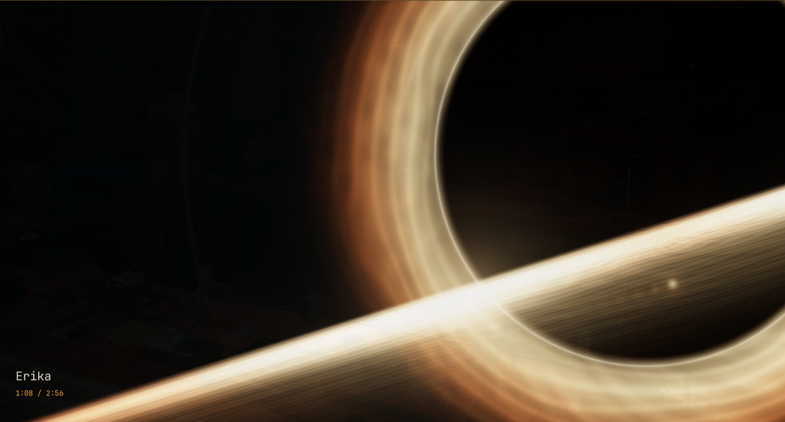

# omaMusi

**A local music player for Linux, with visuals that move to your music.**

Open your music folder, find a song, and start listening. omaMusi plays MP3,
FLAC, WAV, Ogg, Opus, M4A, AAC, and other audio formats. You can use the
keyboard, click a song, or drag music files into the window.



Version **0.11.0** · [MIT license](LICENSE)

Player and search use have been tested on **Omarchy and Ubuntu**. On
Omarchy, the player follows your theme. On GNOME, it uses a normal window
with title-bar controls.

## Install

omaMusi is a native Rust application. Building it needs **Rust 1.92 or
newer**, GTK 4 development libraries, an audio backend and FFmpeg. Running
an installed binary needs GTK 4.6 or newer, FFmpeg and your desktop audio
service. Hardware visuals use OpenGL 3.3; software rendering is available.

### Ubuntu and other Linux desktops

On Ubuntu, install the system build dependencies:

```bash
sudo apt-get install build-essential pkg-config libgtk-4-dev libasound2-dev libpulse-dev libepoxy-dev ffmpeg git desktop-file-utils
```

Install a current [Rust toolchain](https://rustup.rs) (1.92 or newer;
Ubuntu's `apt` Rust is too old, so use rustup). A fresh terminal picks the
toolchain up automatically; if you just installed Rust in this terminal, load
it first and check the version. Then build and install:

```bash
source "$HOME/.cargo/env" # or open a fresh terminal after installing Rust
cargo --version            # must print 1.92 or newer
git clone https://github.com/ariDev1/omaMusi.git
cd omaMusi
bash scripts/setup-player.sh
```

If setup reports `Missing cargo`, your shell has not picked up the Rust
toolchain yet — source the env file above or restart your terminal and try
again.

The installer copies the executable into your user data directory and adds
`~/.local/bin/omaMusi` and an application-menu entry. It preserves music and
saved playlists, including those from the previously managed Python player.
It refuses unrelated launchers, icons and unmanaged installation directories.
The source checkout is not needed to run the installed executable.

For an unmanaged standalone installation, first remove its menu entry with
its original installer, then move its `~/.local/bin/omaMusi` launcher aside
before running setup. Setup refuses to overwrite anything it does not own and
fails with `Another executable already owns ~/.local/bin/omaMusi` or
`Another launcher already exists at ...`. If the original installer is no
longer available (for example a half-removed Python install), remove the
leftovers manually — this keeps your playlists:

```bash
mv ~/.local/bin/omaMusi ~/.local/bin/omaMusi.bak
rm ~/.local/share/applications/io.github.aridev1.omamusi.desktop
```

Keep `omamusi/playlists.json` in your user data directory;
the native player reads that same file. Setup will not replace the unmanaged
installation or execute its Python environment.

Open **omaMusi** from your application menu to load your configured Music
folder recursively. If that folder is unavailable, an empty player opens.
If your terminal cannot find the command, use `~/.local/bin/omaMusi`.

To update, close the player, pull the changes and run setup again:

```bash
git pull --ff-only
bash scripts/setup-player.sh
```

Remove the managed player with `bash scripts/remove-player.sh`. Music and
saved playlists are kept. Manage only the menu entry with
`omaMusi --desktop install` or `omaMusi --desktop remove`.

### Omarchy

The optional bar widget opens the same native player. Install Rust, GTK 4,
ALSA/PulseAudio development libraries, pkg-config and FFmpeg through your
distribution, then install the widget and build the player:

```bash
omarchy plugin add https://github.com/ariDev1/omaMusi.git --enable
bash ~/.config/omarchy/plugins/io.github.aridev1.omamusi/scripts/setup-player.sh
```

An existing native standalone installation can be used by the widget. To
update, close the player, update the plugin and run setup again:

```bash
omarchy plugin update io.github.aridev1.omamusi
bash ~/.config/omarchy/plugins/io.github.aridev1.omamusi/scripts/setup-player.sh
```

Remove the player and widget with:

```bash
bash ~/.config/omarchy/plugins/io.github.aridev1.omamusi/scripts/remove-player.sh
omarchy plugin remove io.github.aridev1.omamusi
```

Your music and saved playlists are kept.

## Open your music

From a terminal, run:

```bash
cd ~/Music
omaMusi
```

Music in that folder and all its subfolders is loaded. Playback starts
automatically. To open a folder from elsewhere, use:

```bash
omaMusi ~/Music --recursive
```

You can also open individual files:

```bash
omaMusi "song.flac" "another song.mp3"
```

Inside the player, press **O** to add files, press **C** to browse folders,
or drag files and folders into the window. Launching omaMusi again brings
the existing window back.

## Find a song

Press **/** and type part of a filename or folder name. Capitalization
doesn't matter. For example, searching for an album folder shows all loaded
songs inside it, including songs in its subfolders.

Press **Up** or **Down** to select a result, then **Enter** to play it.
Press **/** again to edit your search, or erase the text to show all songs.
If nothing matches, you stay in the search field so you can change the text.
Search uses file and folder names; it does not search artist or album tags.

## Keyboard controls

The footer shows the shortcuts, grouped by what they do.

| Key | What it does |
| --- | --- |
| Space | Play or pause |
| Up / Down | Select a song; K / J also work |
| Enter | Play the selected song |
| N / P | Next / previous song |
| R | Turn random playback on or off |
| Left / Right | Skip backward / forward 5 seconds |
| + or = / − | Raise / lower the volume |
| / | Search filenames and folders |
| O or Ctrl+O | Add music files |
| C | Browse folders |
| Ctrl+L | Type a folder path |
| A | Add the selected song to a saved playlist |
| B | Open saved playlists |
| V / Shift+V | Next / previous visual |
| F | Toggle fullscreen |
| Tab | Hide or show the song list |
| Escape | Leave a text field, cancel browsing, or leave fullscreen |
| Q | Quit |

While browsing folders, **Right** or **Enter** opens your selection,
**Left** or **Backspace** goes up one folder, and **L** plays the current
folder. **Up/Down** and **K/J** select items. Press **Escape** to return to
the song list.

Random playback starts off. Press **R** to turn it on; **N** then picks a
random song. **P** goes back through your listening history, or restarts
the current song. Random playback includes songs hidden by your search.

## Save a playlist

Select a song and press **A**. Choose an existing playlist, or select
**Create new playlist…**, type a name, and press **Enter**. If no song is
selected, omaMusi uses the song that's playing. Adding a song leaves the
music playing.

Press **B** to open your saved playlists:

| Key | What it does |
| --- | --- |
| Up / Down | Select a playlist or song |
| Enter | Play the selected playlist |
| Right / Left | View a playlist's songs / return to the playlist list |
| F2 | Rename a playlist |
| Delete | Remove a song from a playlist, or delete a playlist |
| Escape | Cancel or close |

Deleting a playlist asks for confirmation. **Enter** confirms;
**Escape** cancels. Removing a playlist or a song from it never deletes
music files. Missing files are marked and skipped during playback.
Playlists are saved automatically and are available the next time you open
the player.

## Choose a visual

Press **V** to cycle through nine visuals, or **Shift+V** to go back:

- **Event Horizon:** a black hole with a glowing disk.
- **Particle Dance:** dense multicolor particle streams (cyan, green, amber, magenta, violet) flowing with the music. The dots stay small while a higher particle rate keeps the streams full.
- **Phi Cathedral:** changing geometric patterns.
- **Warp:** a flight through colored stars.
- **Spectrum:** frequency bars.
- **Waveform:** glowing sound traces with a transparent background.
- **Spectrogram:** a scrolling view of the sound's frequencies.
- **Cover Art:** your album cover, gently pulsing on a black background.
- **Cover Gallery:** a changing mosaic of album covers. Click one to play a song.

To start with a particular visual:

```bash
omaMusi ~/Music --recursive --view "cover art"
```

Cover Art uses artwork stored in the audio file, or an image named `cover`,
`folder`, `front`, or `album` in the song's folder. JPG, JPEG, PNG, and WebP
images work. If there is no readable cover image, the background stays
black. Visuals do not change the sound or your music files.

### Cover Gallery

The gallery shows covers from your loaded music. One tile changes about
every five seconds with a gentle fade. Hover over a cover to see its song
name or folder and the number of songs sharing it. The tile stays still
under your pointer, so you can click it comfortably.

The covers stay still between transitions, without a music-driven pulse.

Clicking a cover plays a random song with that artwork. If several songs
share the image, omaMusi avoids picking the currently playing song when
there is another choice. With only one cover available, it stays visible.

Covers appear as they are found in the background. Music files without
artwork are skipped. For large collections, the gallery uses a random sample
of up to 128 different covers. You can hide the song list with **Tab** to
give the gallery more room.

Start directly in the gallery with:

```bash
omaMusi ~/Music --recursive --view "cover gallery"
```

## Technical details and development

The animated visuals use OpenGL 3.3 or newer. A simpler software renderer
is available when hardware rendering cannot be used. Native dependencies are listed in [Cargo.toml](Cargo.toml).

Saved playlists are stored in `~/.local/share/omamusi/playlists.json`, or
under `$XDG_DATA_HOME` if you have set it. They refer to your music files,
so moving a file can leave a missing entry in a playlist.

The footer includes the version and Git revision. `+dirty` means local
changes have not been committed; `unknown` means Git information is
unavailable. Check the version in a terminal with `omaMusi --version`.

To run the tests from the project folder:

```bash
cargo fmt --all --check
cargo clippy --locked --all-targets -- -D warnings
cargo test --locked
cargo test --locked --test audio -- --include-ignored --test-threads=1
cargo run --locked --bin render-smoke
cargo run --locked --bin player-smoke
```

The full suite needs access to an audio service; the GPU check also needs
a desktop session and a hardware GPU. GitHub Actions runs regression tests
and builds native release archives. See [compatibility notes](docs/compatibility.md)
for tested dependency versions and detailed desktop checks, and the
[changelog](CHANGELOG.md) for changes between versions.
